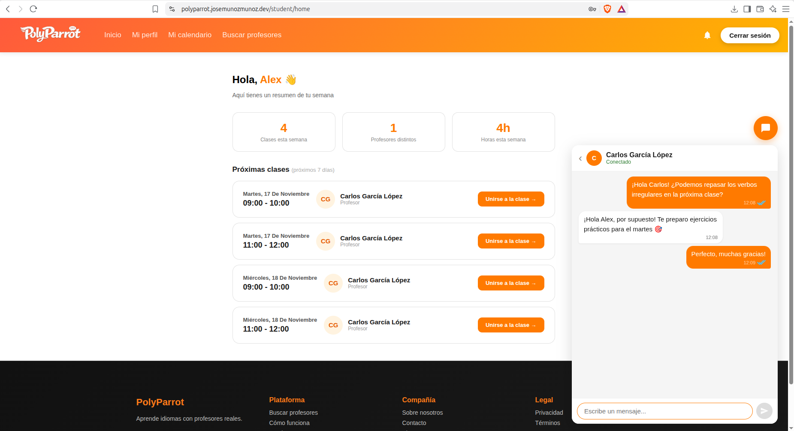
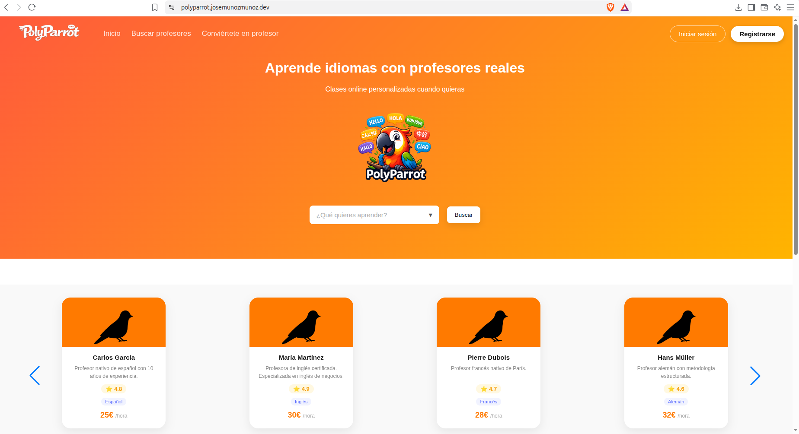
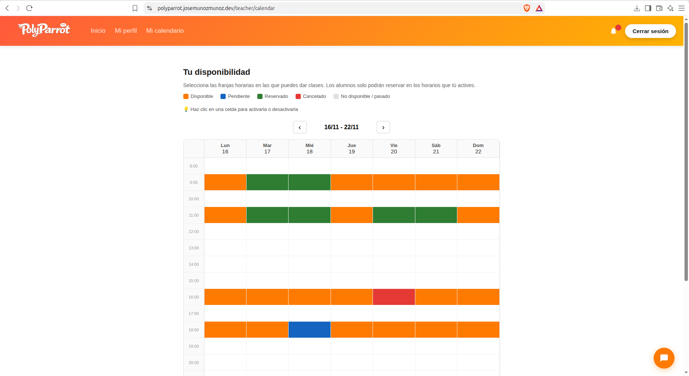
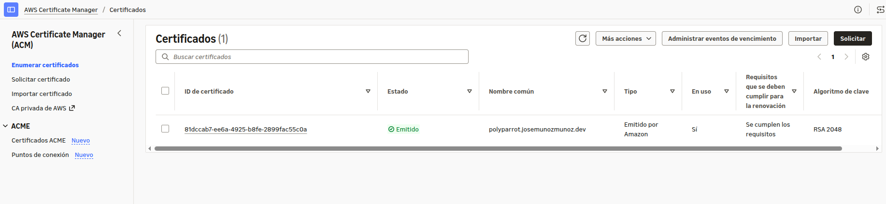
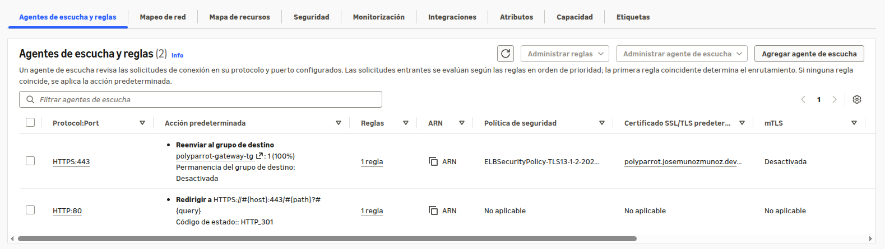
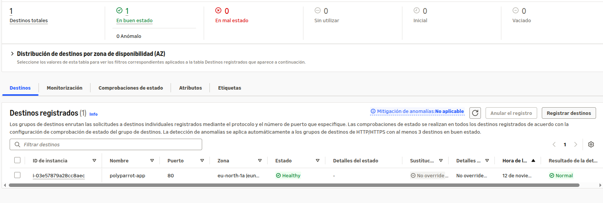

# 🦜 PolyParrot

> A language learning platform connecting students with native teachers — built with a microservices architecture.





---

## What is PolyParrot?

PolyParrot is a full-stack web application inspired by platforms like Preply and iTalki. Students can search for teachers by language, price, and availability, book classes, chat in real time, and receive instant notifications — all from a single interface.

---

## Architecture

PolyParrot is built as a **microservices system** where each service owns its own database and communicates through REST, Feign, WebSocket, and Apache Kafka.

```
┌─────────────────────────────────────────────────────┐
│                    Angular Frontend                  │
│                  (Nginx · port 4200)                 │
└──────────┬──────────┬──────────┬──────────┬─────────┘
           │          │          │          │
    ┌──────▼──┐ ┌─────▼───┐ ┌───▼─────┐ ┌──▼──────────┐
    │  user   │ │ teacher │ │ booking │ │    chat     │
    │ service │ │ service │ │ service │ │   service   │
    │  :8080  │ │  :8081  │ │  :8082  │ │    :8084    │
    │Postgres │ │Postgres │ │Postgres │ │   MongoDB   │
    └─────────┘ └────┬────┘ └────┬────┘ └─────────────┘
                     │  Feign   │
                     └────┬─────┘
                          │ Kafka
                   ┌──────▼──────┐
                   │notification │
                   │   service   │
                   │    :8083    │
                   │   MongoDB   │
                   └─────────────┘
```

### Services

| Service | Port | Database | Responsibilities |
|---|---|---|---|
| `user-service` | 8080 | PostgreSQL | Auth, JWT, user profiles |
| `teacher-service` | 8081 | PostgreSQL | Teacher profiles, availability slots, languages |
| `booking-service` | 8082 | PostgreSQL | Class reservations, confirmations, cancellations |
| `notification-service` | 8083 | MongoDB | Real-time notifications via Kafka + WebSocket |
| `chat-service` | 8084 | MongoDB | Real-time messaging with WebSocket (STOMP) |
| `frontend` | 4200 | — | Angular SPA served by Nginx |

---

## Tech Stack

**Backend**
- Java 17 · Spring Boot 3
- Spring Security · JWT
- Spring Data JPA · Hibernate
- Spring WebSocket · STOMP · SockJS
- Apache Kafka
- OpenFeign (inter-service communication)

**Frontend**
- Angular 17 (standalone components)
- TypeScript
- STOMP.js · SockJS-client

**Infrastructure**
- Docker · Docker Compose
- PostgreSQL 16
- MongoDB 7
- Apache Kafka · Zookeeper
- Nginx

---

## Features

- 🔐 **JWT Authentication** — stateless auth with role-based access (STUDENT / TEACHER)
- 🔒 **Security** — inter-service calls protected with a shared internal secret (`X-Internal-Secret`)
- 🔍 **Teacher search** — filter by language, price, and availability
- 📅 **Booking system** — students book classes, teachers confirm or cancel
- 💬 **Real-time chat** — WebSocket messaging with read receipts and online presence
- 🔔 **Real-time notifications** — Kafka events pushed to the browser via WebSocket
- 📆 **Weekly calendar** — visual class schedule for both students and teachers
- 🎥 **Video classes** — live lessons powered by Jitsi Meet

---

## Getting Started

### Prerequisites
- Docker and Docker Compose

### 1. Clone the repository

```bash
git clone https://github.com/jose200112/polyparrot-app.git
cd polyparrot-app
```

### 2. Start everything

```bash
docker-compose up -d
```

This pulls the pre-built microservice images from Docker Hub, starts PostgreSQL (with seed data), MongoDB, Kafka and Zookeeper. 

> ⚠️ **Wait 2-3 minutes** before opening the app — Spring microservices take time to start up and connect to their databases.

### 3. Open the app

```
http://localhost:4200
```

### Demo credentials

| Role | Email | Password |
|---|---|---|
| Teacher | carlos@polyparrot.com | Parrot_1 |
| Teacher | maria@polyparrot.com | Parrot_1 |
| Student | ana@polyparrot.com | Parrot_1 |

---

## Deploying to AWS (Terraform)

The whole stack can be deployed to AWS with Terraform (`infra/`) and destroyed again with a single command. It is a **launch-test-destroy** setup: I spin it up, check that it works, take screenshots and tear everything down, so it costs only while it is running. That is why there is no live link in this README.

| | |
|---|---|
|  |  |

*Real deployment on AWS, served over HTTPS from a custom domain.*

### Architecture

```
Browser
  │  https://polyparrot.<your-domain>
  ▼
Cloudflare DNS (DNS only, no proxy)  →  CNAME to the ALB
  │
  ▼
┌─ AWS · eu-north-1 · VPC 10.0.0.0/16 ─────────────────────────────
│
│  Public subnets (eu-north-1a, eu-north-1b)
│
│    Application Load Balancer
│      :443  HTTPS  (free ACM certificate)  ──► forward
│      :80   HTTP   ──► 301 redirect to HTTPS
│        │
│        │  HTTP :80 — the instance only accepts traffic
│        │  from the ALB security group
│        ▼
│    EC2 t3.large (Ubuntu 24.04)
│      Docker Compose: nginx gateway, microservices,
│      Kafka + Zookeeper, PostgreSQL, MongoDB
│
└───────────────────────────────────────────────────────────────────
```

Terraform creates **22 resources**: VPC, two public subnets, internet gateway and route table, two security groups, an IAM role and instance profile for SSM, the EC2 instance, the ALB with its listeners and target group, the ACM certificate with its DNS validation, and the DNS records in Cloudflare.





### Design decisions

- **EC2 + Docker Compose instead of EKS or ECS.** The goal is a cheap, quick demo, and the existing `docker-compose.yml` is reused as it is. Moving to a managed orchestrator would be a next step, not a requirement.
- **No NAT Gateway.** It bills per hour even when idle. The instance sits in a public subnet, but its security group only accepts port 80 **from the ALB**, so nothing else can reach it from the Internet.
- **SSM Session Manager instead of SSH.** Port 22 is closed and there is no key pair to manage. The instance role has `AmazonSSMManagedInstanceCore`.
- **IMDSv2 required** and an **encrypted** root volume (30 GB gp3).
- **HTTPS with ACM.** The certificate is free and validated by DNS. TLS terminates at the ALB; between the ALB and the instance traffic stays inside the VPC over HTTP. Cloudflare is used as DNS only (not proxied), so the certificate seen by the browser is the one from ACM.
- **Secrets are not in the code.** The Cloudflare API token is read from the `CLOUDFLARE_API_TOKEN` environment variable, and it is scoped to DNS edit on a single zone. State files and plans are git-ignored.
- **The domain is a variable.** Changing `domain_name` is enough to move the deployment to another domain.

### How to deploy

**Prerequisites**

- [Terraform](https://developer.hashicorp.com/terraform/install) `>= 1.5`
- [AWS CLI v2](https://docs.aws.amazon.com/cli/latest/userguide/getting-started-install.html) with valid credentials (for example `aws login`)
- A domain whose DNS is managed in Cloudflare, and an API token with **Zone → DNS → Edit** for that zone

**Steps**

```bash
cd infra

# Paste the token when prompted (it is not echoed and not saved in the shell history)
read -rs CLOUDFLARE_API_TOKEN && export CLOUDFLARE_API_TOKEN

terraform init
terraform plan -out=tfplan      # review: should end with "Plan: 22 to add"
terraform apply tfplan
```

The first start takes about **5–10 minutes**: the instance installs Docker, clones this repository and runs `docker compose up -d`. Until then the ALB may answer `502`. Then open the URL printed by:

```bash
terraform output site_url
```

To get a shell on the instance without SSH (needs the [Session Manager plugin](https://docs.aws.amazon.com/systems-manager/latest/userguide/session-manager-working-with-install-plugin.html)), use the command from `terraform output ssm_command`, or connect from the EC2 console.

**Tear everything down** (do not forget this one):

```bash
terraform destroy
```

**Variables** (`infra/variables.tf`)

| Variable | Default | Description |
|---|---|---|
| `aws_region` | `eu-north-1` | Region where everything is created |
| `project_name` | `polyparrot` | Prefix for resource names and tags |
| `instance_type` | `t3.large` | EC2 type (x86; avoid `t4g`, which is ARM) |
| `repo_url` | this repository | Repo with the `docker-compose.yml` to run |
| `domain_name` | `josemunozmunoz.dev` | **Change it to your own domain** |
| `subdomain` | `polyparrot` | The app is published at `subdomain.domain_name` |
| `cloudflare_zone_id` | my zone | **Change it to the Zone ID of your domain** |

### Cost

The only things that bill while it is up are the EC2 instance, the Application Load Balancer and the public IPv4 addresses. The ACM certificate is free. Each test runs for well under an hour, and the account has budget alerts set up as a safety net.

<!-- TODO: add the real cost of one test run after checking Cost Explorer -->

### Limitations and next steps

- Single instance, so there is **no high availability**. The ALB spans two subnets, but only one target is behind it.
- Databases run in containers on the same instance and the root volume is deleted on termination, so **data is not persistent**. This is fine for a demo.
- Terraform state is **local**. A natural next step is an S3 backend with locking.
- DNS is managed in Cloudflare. Route 53 would be the natural choice for health checks, failover routing and alias records at the apex domain.
- Every service publishes its port in `docker-compose.yml` (inherited from local development). On AWS only the ALB can reach the instance, so they are not exposed, but a next step is to bind databases and Kafka to `127.0.0.1` and drop the `ports:` that are not needed.
- Possible next steps: ECS/Fargate or EKS, RDS for PostgreSQL, private subnets with VPC endpoints, and a CI pipeline that runs `terraform validate` and `plan`.

---

## Project Structure

```
polyparrot-app/
├── backend/
│   ├── user-service/
│   ├── teacher-service/
│   ├── booking-service/
│   ├── notification-service/
│   └── chat-service/
├── frontend/
│   ├── src/
│   ├── Dockerfile
│   └── nginx.conf
├── docker/
│   └── postgres/
│       ├── 01-init-databases.sql
│       ├── 02-seed-users.sql
│       ├── 03-seed-teachers.sql
│       └── 04-seed-bookings.sql
├── docs/
│   └── screenshots/
├── infra/                    # Terraform (AWS)
└── docker-compose.yml
```

---

## Future improvements

- API Gateway (Spring Cloud Gateway) as a single entry point
- Rating and review system

---

## License

MIT
